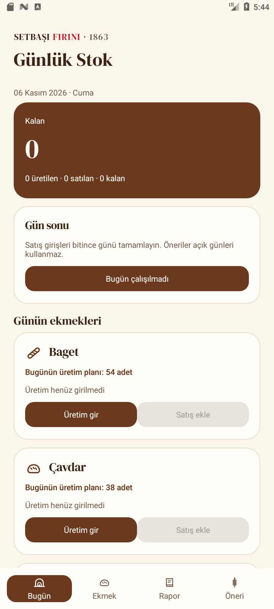
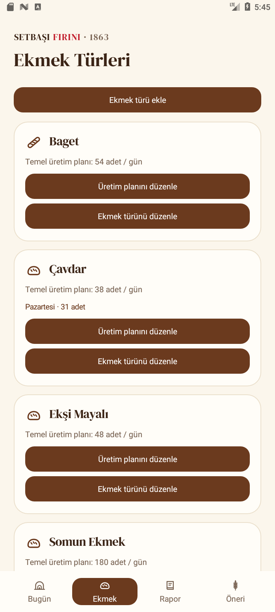
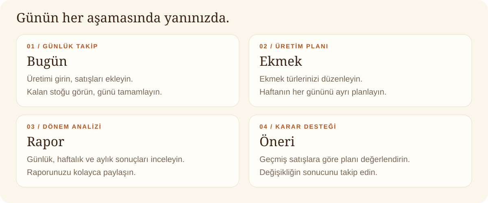
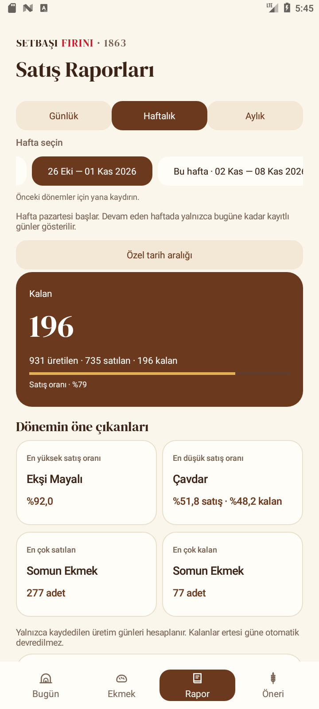
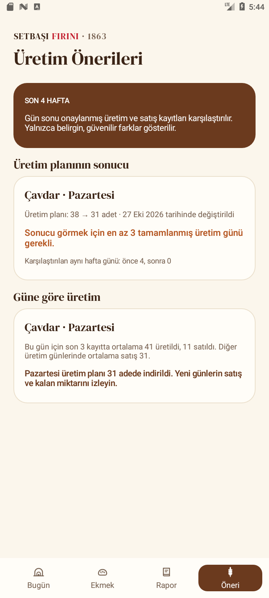

<div align="center">


# Setbaşı Fırını

**Bugün ne kadar ürettik, ne kadar sattık, ne kadar kaldı?**

Ekmek üretimini, satışları ve kalan stoğu tek yerden takip eden Türkçe Android uygulaması.

**Türkçe arayüz · Çevrimdışı kullanım · Android 7.0 ve üzeri**

[Özellikler](#özellikler) · [Günlük kullanım](#günlük-kullanım) · [Kurulum](#kurulum-ve-çalıştırma)

</div>

## Fırının günlük işini kolaylaştırır

Sabah üretimi girin, gün içinde satışları ekleyin, akşam kalan ekmekleri görün. Geçmiş kayıtları karşılaştırarak haftalık üretim planınızı şekillendirin.

Setbaşı Fırını, adet bazında üretim ve stok takibine odaklanır. Temel işlemler internet bağlantısı gerektirmez; kayıtlar cihazdaki SQLite veritabanında saklanır. Tarihler ve gün sonu işlemleri Türkiye saatine göre hesaplanır.

## Özellikler

Günlük takipten üretim planına kadar dört ana bölüm. Aşağıdaki ekran görüntüleri, emülatörde çalışan geliştirme sürümünden alınmıştır; görünen kayıtlar tanıtım amaçlı örnek verilerdir. Kapak ve bölüm arası çizimler uygulamanın görsel dilini tamamlayan illüstrasyonlardır.

<table>
  <tr>
    <th>Bugün · Günlük stok</th>
    <th>Ekmek · Üretim planı</th>
  </tr>
  <tr>
    <td align="center"></td>
    <td align="center"></td>
  </tr>
  <tr>
    <td align="center">Günün üretimini ve satışlarını tek ekrandan yönetin.</td>
    <td align="center">Her ekmek için haftalık üretim planını belirleyin.</td>
  </tr>
</table>

### 🍞 Bugün — Günlük üretim, satış ve stok

- Her ekmek için planlanan üretimi görün ve **gerçek üretim adedini** kaydedin.
- Satışları ekleyin; üretilen, satılan ve kalan adetleri birlikte izleyin.
- Hatalı satışları **Satışları düzelt** ile geri alın. Geri alınan kayıtlar düzeltme geçmişinde korunur.
- Stoktan fazla satış veya satılmış adetten düşük üretim girişini engelleyen kontrollerden yararlanın.
- İşlemler bittiğinde **Günü tamamla** ile gün sonunu onaylayın; düzeltme gerektiğinde günü yeniden açın.
- Kapalı olunan günleri **Çalışılmadı**, erken tükenen ekmekleri **Erken tükendi** olarak işaretleyin.

### 🗓️ Ekmek — Ürünler ve haftalık plan

- Ekmek türlerini ekleyin, adlarını ve temel günlük üretim planlarını düzenleyin.
- Haftanın her günü için ayrı üretim adedi belirleyin.
- Kullanılmayan ekmekleri arşivleyin; geçmiş üretim ve satış kayıtlarını raporlarda koruyun.
- Planlanan miktarla günlük gerçek üretimi ayrı takip edin.

### 📊 Rapor — Kayıtlardan anlaşılır sonuçlara



- **Günlük, haftalık, aylık veya özel tarih aralığı** için rapor oluşturun.
- Toplam üretimi, satışı, kalan adedi ve satış oranını inceleyin.
- En çok satılan, en çok kalan, satış oranı en yüksek ve en düşük ekmekleri görün.
- Haftalık satışları gün gün izleyin; ekmek bazında günlük döküme ulaşın.
- Rapor metnini **WhatsApp, WhatsApp Business veya başka bir uygulama** üzerinden paylaşın.

### 🌾 Öneri — Geçmişe göre üretim planı

- Son dört haftanın tamamlanmış günlerinden üretim ve satış örüntülerini inceleyin.
- Belirli hafta günlerinde düzenli olarak fazla kalan ekmekler için kademeli azaltma önerileri alın.
- Karşılaştırılabilir haftalardaki belirgin satış değişimlerini görün.
- Plan değişikliğinden sonra üretim, satış ve kalan miktarlarının nasıl değiştiğini takip edin.

<table>
  <tr>
    <th>Rapor · Satışların özeti</th>
    <th>Öneri · Üretim kararları</th>
  </tr>
  <tr>
    <td align="center"></td>
    <td align="center"></td>
  </tr>
  <tr>
    <td align="center">Satış oranlarını ve en çok kalan ekmekleri görün.</td>
    <td align="center">Geçmiş kayıtlara göre planınızı değerlendirin.</td>
  </tr>
</table>

## Günlük kullanım

| Adım | Yapılacak işlem | Kazanım |
| --- | --- | --- |
| **1 · Hazırlık** | Ekmekleri ekleyin, haftalık üretim planını belirleyin. | Günlere göre üretim planı. |
| **2 · Sabah** | O günün gerçek üretimini girin. | Takibe hazır günlük stok. |
| **3 · Gün içinde** | Satışları ekleyin, hatalı girişleri geri alın. | Güncel satış ve kalan miktarı. |
| **4 · Gün sonu** | Kayıtları kontrol edip günü tamamlayın. | Öneriler için onaylı veri. |
| **5 · Değerlendirme** | Raporları ve üretim önerilerini inceleyin. | Sonraki üretim planı için karşılaştırma. |

> **Örnek:** 120 adet üretim ve toplam 95 adet satış kaydedildiğinde kalan stok 25 adettir. Ek üretim yaparsanız **Üretim gir** alanına günün yeni toplamını yazın; satış girişleri ise mevcut satışlara eklenir.

Kalan ekmekler ertesi güne otomatik devredilmez. Her günün gerçek üretimi ayrıca kaydedilir.

## Üretim önerileri nasıl çalışır?

Öneriler, uygulama içinde çalışan kurallara ve kayıtlı geçmişe dayanır. Açık günler öneri hesabına katılmaz. Tahmini, tutarsız veya tükenme nedeniyle gerçek talebin bilinmediği kayıtlar azaltma önerilerinde güvenilir veri olarak kullanılmaz.

Yeterli veri ve belirgin bir fark olduğunda uygulama, ilgili ekmek ve hafta günü için bir üretim taslağı sunar. Taslak, mevcut plana göre **en fazla %20 azaltma** ve gözlenen en yüksek satışın üzerinde pay bırakma yaklaşımıyla hesaplanır. Kullanıcı miktarı düzenleyip onaylar.

Planın etkisini değerlendirmek için değişiklik öncesi ve sonrası aynı hafta günleri karşılaştırılır. Yeterli kayıt yoksa uygulama bunu belirtir; satış da düşmüşse veya ürün tükenmişse sonucu başarılı bir azaltma olarak sunmaz.

## Tasarım ve kullanım

- **Tamamen Türkçe:** Ekran başlıkları, açıklamalar, uyarılar ve rapor metinleri Türkçedir.
- **Fırına özgü görsel dil:** Krem zemin, sıcak kahverengi tonları, ekmek simgeleri ve taş fırın illüstrasyonu.
- **Açık ve koyu tema:** Sistem temasına uygun renkler.
- **Yerel kayıt:** Üretim, satış ve planlama için sunucu bağlantısı gerekmez. Rapor paylaşımı, seçilen uygulamanın bağlantı koşullarına bağlıdır.

## Kurulum ve çalıştırma

Projeyi Android Studio ile açın. **JDK 17 veya üzeri**, **Android SDK 35** ve Android 7.0 veya üzeri bir cihaz/emülatör gerekir.

```bash
git clone https://github.com/Mucahid-Cinar/bakeryApp.git
cd bakeryApp
```

Windows PowerShell üzerinden geliştirme APK'sını oluşturun:

```powershell
.\gradlew.bat assembleDebug
```

Oluşan APK: `app/build/outputs/apk/debug/app-debug.apk`

Android Studio'da **Run** ile uygulamayı çalıştırabilirsiniz. macOS/Linux üzerinde eşdeğer komut `./gradlew assembleDebug` olur.

> Geliştirme sürümü `com.example.bakeryapp.qa` uygulama kimliğiyle ayrı kurulur ve örnek verilerle açılır. Normal sürümün kimliği `com.example.bakeryapp` şeklindedir.

## Teknik yapı

| Bileşen | Kullanılan teknoloji |
| --- | --- |
| Dil | Java — kaynak uyumluluğu Java 11 |
| Arayüz | Android Views, Material Components / Material 3 teması |
| Veri saklama | Yerel SQLite |
| Android desteği | Minimum SDK 24 · Hedef ve derleme SDK 35 |
| Sürüm | 1.1 |
| Birim testleri | JUnit |
| Cihaz testleri | AndroidX Test ve Espresso |

<details>
<summary><strong>Geliştiriciler için kaynaklar ve test komutları</strong></summary>

- [MainActivity.java](app/src/main/java/com/example/bakeryapp/MainActivity.java): Ekranlar ve kullanıcı işlemleri.
- [DBHelper.java](app/src/main/java/com/example/bakeryapp/DBHelper.java): Veritabanı ve kayıt işlemleri.
- [ProductionAdvisor.java](app/src/main/java/com/example/bakeryapp/ProductionAdvisor.java): Üretim önerileri ve plan sonucu değerlendirmesi.
- [ReportMessage.java](app/src/main/java/com/example/bakeryapp/ReportMessage.java): Paylaşılabilir rapor metni.
- [strings.xml](app/src/main/res/values/strings.xml): Türkçe arayüz metinleri.

```powershell
# Birim testleri
.\gradlew.bat testDebugUnitTest

# Bağlı cihaz veya emülatör gerektirir
.\gradlew.bat connectedDebugAndroidTest
```

Test kaynakları tarih hesaplamaları, raporlar, üretim önerileri, veritabanı ve günlük işlem akışlarını kapsar.

</details>

## Yazı tipi lisansı

Başlıklarda kullanılan **DM Serif Display**, SIL Open Font License ile dağıtılır. [Lisans metnini inceleyin.](licenses/DMSerifDisplay-OFL.txt)
